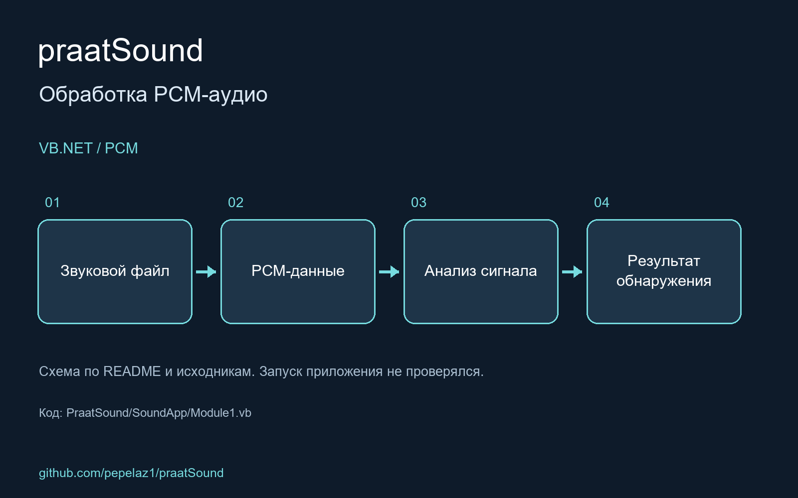

# praatSound

Application to detect specific noices in PCM sound written in VB.NET

<!-- portfolio-visual:start -->
## Схема работы

Схема подготовлена по README и исходному коду. Запуск приложения не проверялся.
<!-- portfolio-visual:end -->
